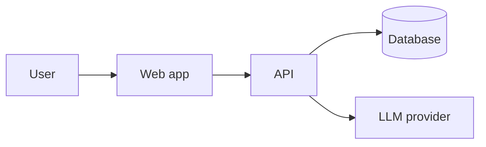

# Architecture: <name>

Status: Draft | Approved (Gate 2, <date>)

## 1. Overview (plain language)
<one paragraph the owner can understand>

## 2. Diagram

## 3. Tech stack
| Layer | Choice | Why (plain) | ADR |
|---|---|---|---|

## 4. Components and responsibilities
| Component | Responsibility | REQs served |
|---|---|---|

## 5. Data model
<entities, key fields, relations, Mermaid erDiagram>

## 6. API / interfaces
<endpoints or key functions, inputs and outputs>

## 7. AI design
- Models (primary / fallback), config location:
- Prompt management (files, versioning):
- Retrieval / tools / agents:
- Evals (golden set location, metrics, thresholds → AIQ IDs):
- Guardrails (input/output validation, prompt-injection defenses):
- Cost and latency budget:

## 8. Security model
<authn, authz, secrets, data protection, threat highlights>

## 9. Deployment and environments
<where it runs, envs, CI/CD flow>

## 10. NFR coverage
| NFR | How it's met | How it's verified |
|---|---|---|

## 11. Cost estimate (monthly)
| Item | Low | Expected | High |
|---|---|---|---|

## 12. Risks
| Risk | Likelihood | Impact | Mitigation |
|---|---|---|---|
